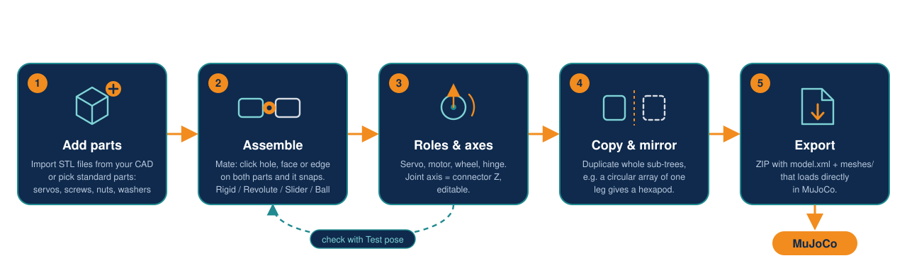

<p align="center"></p>

<h1 align="center">stl2mujoco</h1>

Turn CAD parts (STL) into a **MuJoCo** robot model, in a browser-based visual editor, or headless from a CAD assembly (STEP).
Mass and inertia are computed from the meshes, servos come from a library with datasheet torque and speed, and the export is a ZIP with
`model.xml` + `meshes/` that loads directly in MuJoCo.

<p align="center"></p>

## Quick start

```bash
npm install
npm run dev          # editor at http://localhost:5173
```

Run an exported model:

```bash
unzip robot_mujoco.zip
python -m mujoco.viewer --mjcf=robot/model.xml
```

## Example: Crabsy hexapod


[Crabsy](https://github.com/SamuelNoesslboeck/Crabsy) is a 3D-printed hexapod with 18 servos. Its STL files plus the assembly exported as STEP are enough
to rebuild it: one leg of three MG996R servos is described in [`examples/crabsy/robot.json`](examples/crabsy/robot.json), every other leg is cloned at its real position.

```bash
git clone --depth 1 https://github.com/SamuelNoesslboeck/Crabsy
node cli/import-step.mjs Crabsy/construction a_crabsy.stp crabsy.s2m.zip --config examples/crabsy/robot.json
node cli/convert.mjs crabsy.s2m.zip out/crabsy       # MJCF export (or open the .s2m.zip in the editor)
python examples/crabsy/walk.py                       # walks the robot in MuJoCo (pip install mujoco)
```

Only the feet have collision geometry, and the aluminium servo flanges (no STL in the repo) are not modelled.
The same steps work for your own robot, see [STEP import](docs/step-import.md).

## Documentation

| Page | Contents |
|---|---|
| [Using the editor](docs/editor.md) | Interface overview, assembly mates |
| [STEP import](docs/step-import.md) | Folder of STLs + CAD assembly to robot, the `robot.json` format |
| [STL files and refreshing a part](docs/stl-and-refresh.md) | What an STL can carry, updating a part from a new STL |
| [Datasheet parts](docs/datasheet-parts.md) | Add a standard part from a datasheet with a headless Claude Code session |
| [Export accuracy](docs/export-accuracy.md) | Units, mass and inertia, servos, collision, checks |
| [Standard parts library](standard_parts/README.md) | Servos, screws, nuts, washers |
| [Development](docs/development.md) | Project layout, tests, roadmap and known limits |