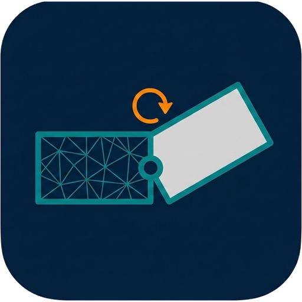
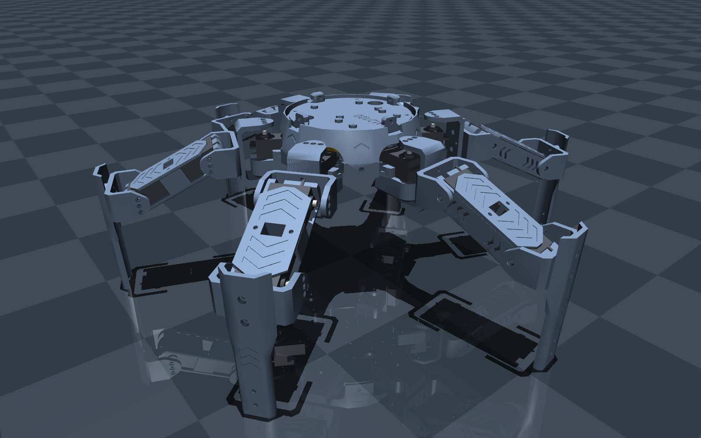

<p align="center"></p>

<h1 align="center">stl2mujoco</h1>

A browser-based visual editor that turns CAD parts (STL) into a **MuJoCo** robot model.

1. **Add parts** – import STL files from your CAD, or pick **standard parts** (servos, screws, nuts, washers) from the *Parts library*.
2. **Assemble like in a CAD program** – click the **link icon (Mate, key M)** in the toolbar, click a hole / face / edge (or a green marker) on the part to move, then on the part it attaches to. It snaps into place; choose *Rigid*, *Revolute*, *Slider* or *Ball*, flip, offset and rotation.
3. **Define roles and axes** – servo joints, motors, wheels, passive hinges; joint axes are the connector Z axes (or edit them); *Test pose* sliders let you check the motion.
4. **Copy and mirror** whole sub-trees (e.g. circular array of one leg → hexapod).
5. **Export** a ZIP with `model.xml` + `meshes/` that loads directly in MuJoCo.

```bash
npm install
npm run dev          # editor at http://localhost:5173
npm test             # unit tests (Node + the `mujoco` Python package, `pip install mujoco`)
npm run build        # static build in dist/
```

Run the exported model:

```bash
unzip robot_mujoco.zip
python -m mujoco.viewer --mjcf=robot/model.xml
```

## The interface at a glance

Everything is icon-first; hover an icon for its name and a short explanation.

- **Toolbar:** import (↓), mate (🔗), add box / cylinder, unit of imported STLs · drop to floor, open, save · status chip (✓ / ⚠ n – click for the list of checks), settings (sliders) · **Export**.
- **Left:** structure tree (icon = role) or the parts library (grid tab). **Drop STL files anywhere** in the 3D view to import them.
- **3D view:** floating bar with move / rotate, what to move (part + joint, part only, joint frame only) and "take children along".
- **Inspector (right):** name, **role icons** (floating base, fixed base, link, servo, motor, wheel, slider, hinge, ball), an action bar (copy, paste, duplicate, mirror X/Y/Z, arrays, apply to copies) and collapsible sections – *Placement, Joint, Servo / Drive, Mass & collision, Connectors, Part file, Library part, Copies*. Rarely used numbers sit behind the sliders-icon fold; sections that matter for the selected part open by themselves.

## What makes the export accurate

| Topic | What is done |
|---|---|
| Units | Everything is SI (m, kg, rad). Meshes are scaled by MuJoCo's `scale` – STL data is exported unmodified. |
| Mass / inertia | Volume, centre of mass and the **full inertia tensor** are integrated exactly from the triangle mesh (signed tetrahedra) in the joint frame and written as an explicit `<inertial … fullinertia>`. Mass comes from a material density **or** a measured mass (then the tensor is scaled). Verified against analytic box/cylinder/sphere values in the tests. |
| Kinematics | Poses are stored in world space in the reference pose and converted to parent-relative `pos`/`quat`; joint axes are expressed in the joint frame. |
| Servos | Datasheet torque and speed are reproduced: position actuator clipped at the **stall torque** plus joint damping = stall torque ÷ no-load speed (the DC-motor torque/speed line), so a servo never exceeds its no-load speed and is overpowered above its stall torque. Verified in MuJoCo tests. Inertia/friction are flagged estimates. See [standard_parts](standard_parts/README.md). |
| Collision | Separate invisible collision geoms (group 3). MuJoCo uses the **convex hull** of a mesh; large meshes are simplified (default ≤ 20 000 triangles) for collision only. Visuals are exported 1:1. Concave parts (e.g. a ring) collide as their hull – split them or disable collision where that matters. |
| Checks | Warns about non-watertight meshes (mass unreliable → use measured mass), joints without mass, bad ranges, parts below the floor, etc. |
| Sensors | Optional joint position/velocity sensors and a base IMU (gyro, accelerometer, pose). |

## STL files carry no assembly information

CAD assemblies (Solid Edge `.asm`, …) are proprietary, and STL files are exported per part in their own coordinate system,
so **part placement and joint axes cannot be recovered automatically**. That is what the visual editor is for.
Tip: export STLs from the *assembly* (positions preserved) if your CAD supports it – then parts are already in place and only roles/joints are needed.

## What an STL can (and cannot) carry – and "Refresh part"

An STL is **only a bag of unnamed triangles**: no hole names, no features, no parameters, not even units. A hole is just
a ring of triangles. So nothing in the file says "this is the servo hole" – the editor *recognises geometry* instead
(circular rims → hole/boss centres, planar faces, edges) and stores your connectors as frames on the part.

When you change a part in CAD (say, a longer link), re-export the STL and click the **refresh icon** in that part's *Part file* section
(in Chromium the editor remembers the file you imported, so it is one click):

1. each connector is re-found on the new mesh – a hole connector matches a hole of the **same radius and direction**,
   a face connector the face with the same normal;
2. the expected position keeps the **offset from the nearest end** of the part on every axis, so the near holes stay
   and the far holes move with the far end;
3. every part attached to it by a mate is **re-snapped with its sub-assembly** – no need to place anything again;
4. a report lists what was found, what moved by how many mm, and what was not found (those mates are left untouched).

Only the geometry you change should change: if you also move holes around, add holes of the same size next to each
other, or remove one, the matching can pick a different hole or report it as *not found* – check the report.
STEP files do carry exact cylindrical faces (and sometimes names); importing STEP is a possible future improvement.

## Add a part from a datasheet (headless Claude Code)

In the **parts library** tab (grid icon, left) click **✨ From datasheet**, upload the datasheet (PDF, image, text – several files are fine),
optionally **link your own STL** for the shape, pick a category and give hints. The editor starts a **headless Claude Code session**
(`claude -p`) that reads the datasheet, extracts dimensions, mounting holes, mass, torque/speed and writes a *part spec*;
the editor validates it and generates the meshes and `part.json`. You then **review** the values (estimates are highlighted),
**try the part in the scene** and finally **install** it into `standard_parts/` – commit that folder to share it.

- **Availability:** needs the editor server (`npm run dev`, or `npm run build && npm run serve`) **and** the Claude Code CLI
  (`npm i -g @anthropic-ai/claude-code`, sign in once with `claude`). If either is missing the dialog says so and stays disabled.
  `S2M_CLAUDE_BIN` points to another binary, `S2M_CLAUDE_MODEL` selects a model, `S2M_CLAUDE_BUDGET` caps the cost per run (default 1.5 USD, typically ~0.05 USD).
- **Safety:** the API listens on 127.0.0.1 only and accepts same-origin requests only. The Claude session runs in a throw-away
  directory with only `Read`/`Glob`/`Write` (no shell, no web, no MCP, no user settings), a turn/time/budget limit, and is told that the datasheet
  is untrusted data. Its only deliverable is one JSON spec, which is whitelisted and range-checked (`src/core/part-spec.js`) before trusted code generates the part;
  invalid specs are sent back once for repair.
- **Part types:** `hobby_servo` (case + ears + spline), `block_servo` (Dynamixel style), `block` (boards/plates with holes), `cylinder`, and `stl` (your mesh + connectors from the datasheet).
  The accepted spec format is documented in `server/claude.mjs` (`SCHEMA_DOC`).

## Assembly mates

A *connector* is a frame on a part (green marker: origin + Z = surface normal / axis). In **Mate** mode you click on the geometry and the editor snaps to **hole/boss centres**, **face centres**, **vertices** or **edge midpoints** (or an exact point); library parts already carry connectors for their mounting holes and shaft.
A mate puts the two connectors together face-to-face (Flip aligns the Z axes instead), with optional offset and rotation, moves the part *and everything attached to it*, makes it a child of the target and sets the joint: rigid = welded, revolute = hinge about connector Z, slider = slide along Z, ball. Servo outputs are already hinge joints – mate your links rigidly to the servo's `output_top` marker.

## Build a robot from a folder of STLs + a STEP assembly

STL files carry no placement, but a CAD assembly does. Export the assembly as **STEP** (Solid Edge: Save As, `.stp`; other CAD systems work the same)
and build the whole robot from it: exact part poses, library servos, repeated limbs cloned at their real positions.

```bash
node cli/import-step.mjs <stl-folder> <assembly.stp> --suggest robot.json               # 1. inspect: writes a starting config
node cli/import-step.mjs <stl-folder> <assembly.stp> out.s2m.zip --config robot.json    # 2. build (after reviewing robot.json)
node cli/convert.mjs out.s2m.zip out/robot                                              # 3. headless MJCF export (or open the zip in the editor)
```

- **Geometry** comes from the STL files (searched recursively). A STEP part is matched to an STL by name, ignoring case and `_`/`-`/spaces
  (`1_baseplate` matches `1_base_plate.stl`); use `"stl": { "product": "file.stl" }` for odd names. Parts without an STL are reported and left out.
- **Placement** comes from the STEP file: the assembly tree and every transform (`src/core/step-asm.js`).
- **Kinematics** are *not* in STEP, so they live in a small `robot.json`: which parts sit on which side of which servo.
  `--suggest` writes a first guess (each part goes to the servo whose shaft is nearest; every servo turns its output and hangs from the
  previous one). Check it against the CAD. In particular, a servo whose *body* turns around a fixed shaft needs `"moves": "case"`.

```jsonc
{
  "base":  { "assembly": "a1_base", "root": "1_baseplate" },        // rigid body with the free joint
  "servoModel": { "library": "servo_mg996r", "case": "Case", "shaft": "Shaft" },   // STEP part names of the servo's two halves
  "limb": { "assembly": "a2_leg", "label": "leg",                    // built once, every other instance is cloned
    "servos": [                                                      // ordered from the base outwards
      { "parent": "base",     "moves": "output", "case": ["1_lower_bearing"], "output": ["5_connector@0"] },
      { "parent": "0.output", "moves": "case",   "case": ["2_middle_segment"] },
      { "parent": "1.case",   "moves": "output", "output": ["4_foot_shell"] }
    ] },
  "boxes":  [{ "name": "battery", "size_mm": [70, 18, 15], "at_mm": [0, 0, 25], "mass_kg": 0.1 }],   // parts missing in the STEP
  "collision": { "4_foot_shell": "mesh" }, "ignore": ["screws"], "density": 400
}
```

`"product@k"` picks, of several instances of one part, the one nearest to the shaft of servo *k*. Joint zero is the pose of the exported assembly.
Limits: the base and the limb must be top-level assemblies; one limb type; servos come from the standard parts library; screws, flanges and other
STEP parts without an STL are left out.

### Example: Crabsy hexapod



[`examples/crabsy/robot.json`](examples/crabsy/robot.json) describes [Crabsy](https://github.com/SamuelNoesslboeck/Crabsy): one leg of three MG996R servos
(coxa, femur, whose servo body turns around the fixed shaft, and tibia), repeated x6.

```bash
git clone --depth 1 https://github.com/SamuelNoesslboeck/Crabsy
node cli/import-step.mjs Crabsy/construction a_crabsy.stp crabsy.s2m.zip --config examples/crabsy/robot.json
node cli/convert.mjs crabsy.s2m.zip out/crabsy
python examples/crabsy/walk.py        # walks the exported robot in MuJoCo
```

Only the feet have collision geometry: convex hulls of neighbouring printed parts overlap and would push against each other.
The aluminium servo flanges have no STL in the repo and are not modelled.
## Project layout

- `src/core` – DOM-free logic: STL, mass properties, project model, MJCF exporter, zip IO
- `src/ui` – Three.js viewport, styles; `src/main.js` – panels and app logic
- `cli/convert.mjs` – headless export; `cli/import-step.mjs` – STL folder + STEP assembly to project; `tests/` – Vitest + MuJoCo validation

## Roadmap / known limits

- Servo hole patterns/shaft offsets are typical values (see [standard_parts](standard_parts/README.md)); verify against your servo.
- No in-browser physics preview yet (export and use `mujoco.viewer`); MuJoCo-WASM preview is a natural next step.
- Test-pose slider supports hinge and slide joints (not ball/free).
- URDF import / export is not implemented.
